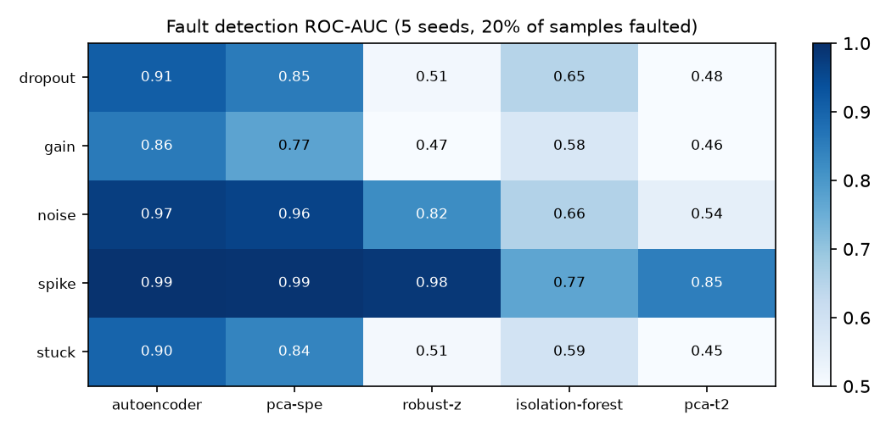
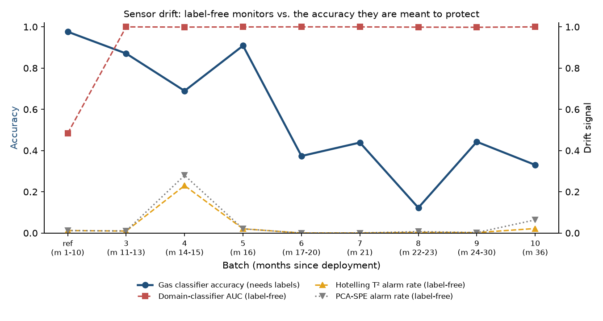

# sensor-drift-monitor

**Detecting failing sensors and silent drift in a real chemical sensor array, three years after deployment.**

Field sensors fail in two very different ways. Some *break*: a stuck element, a dropout, a spike. Others *drift*: they age slowly, every reading still looks plausible, and the models built on them quietly stop being right. This project builds and benchmarks monitors for both on the [UCI Gas Sensor Array Drift dataset](https://archive.ics.uci.edu/dataset/224/gas+sensor+array+drift+dataset): 13,910 measurements from 16 metal-oxide gas sensors (128 features), collected in 10 batches over 36 months.

## Key findings

1. **For single-sensor faults, an autoencoder and PCA-SPE dominate** (ROC-AUC 0.86–0.99 and 0.77–0.99). PCA-SPE gets most of the way at a fraction of the complexity and is easier to explain. Per-feature z-scores only catch gross spikes, and Isolation Forest struggles in 128 dimensions.
2. **At a strict ~1% false-alarm rate, only gross faults are caught reliably from a single reading** (spikes: 100% recall with the autoencoder). Subtle faults (sensitivity loss, stuck, dropout) separate well on average but need evidence pooled over time to alarm confidently.
3. **Drift is invisible one reading at a time but obvious batch by batch.** After months 1–10, nearly every later sample sits inside the healthy envelope (alarm rates 0–6%, except batch 4). Yet a domain classifier separates new batches from the reference with AUC ≈ 1.00, and PSI jumps from 0.02 to 0.65 at the first new batch. **That is one batch before the gas classifier's accuracy falls below 80%.**
4. **Drift metrics tell you *when* to recalibrate, not *how much* accuracy you have lost.** Across batches, none of the label-free signals tracks accuracy closely (|Spearman ρ| ≤ 0.38, n = 9). In practice: alarm on drift, then confirm with a small labeled spot-check before retraining.

## Study 1: fault detection benchmark

Faults are injected into held-out *healthy* data from the reference period (batches 1–2), so drift does not confound the result. Each fault corrupts all 8 features of one randomly chosen sensor, the way a single failing element looks in an array:

| Fault | Physical analogue |
|---|---|
| `stuck` | element frozen at a stale reading |
| `dropout` | element stops responding (reads zero) |
| `spike` | transient electrical spike (±6σ) |
| `gain` | sensitivity loss / poisoning (response × 0.4) |
| `noise` | loose contact or EMI (heavy additive noise) |

Detectors are fit on healthy training data, and their alarm threshold is set at the 99th percentile of scores on a separate healthy calibration set (~1% false-alarm rate). The study uses 5 seeds, with 20% of test samples faulted.



**Recall at the ~1% false-alarm threshold**

| fault | autoencoder | pca-spe | robust-z | isolation-forest | pca-t2 |
|:--|--:|--:|--:|--:|--:|
| spike | **1.00** | 0.76 | 0.53 | 0.00 | 0.05 |
| noise | 0.21 | 0.09 | **0.26** | 0.00 | 0.01 |
| dropout | **0.08** | 0.03 | 0.01 | 0.00 | 0.00 |
| stuck | **0.04** | 0.03 | 0.01 | 0.00 | 0.01 |
| gain | 0.01 | 0.01 | 0.01 | 0.00 | 0.00 |

Why PCA-SPE works and Hotelling's T² does not here: a single bad sensor *breaks the correlation structure* between sensors. That shows up in the residual (SPE, the Q statistic), not in the principal-component scores that T² measures. The two statistics are complementary, which is why statistical process monitoring uses them as a pair. The unit tests check each one on the kind of fault it is designed for.

## Study 2: drift over 36 months

A gas classifier (random forest) and the monitors are frozen on batches 1–2 (months 1–10), then data from months 11–36 is replayed batch by batch.



| batch | months | n | gas accuracy | PSI | domain AUC | SPE alarms | T² alarms |
|:--|:--|--:|--:|--:|--:|--:|--:|
| ref (held-out) | 1–10 | 338 | 0.976 | 0.022 | 0.483 | 0.012 | 0.012 |
| 3 | 11–13 | 1586 | 0.871 | **0.646** | **1.000** | 0.010 | 0.009 |
| 4 | 14–15 | 161 | **0.689** | 2.988 | 0.999 | 0.280 | 0.230 |
| 5 | 16 | 197 | 0.909 | 3.808 | 1.000 | 0.020 | 0.020 |
| 6 | 17–20 | 2300 | 0.373 | 1.947 | 1.000 | 0.000 | 0.000 |
| 7 | 21 | 3613 | 0.439 | 1.784 | 1.000 | 0.000 | 0.000 |
| 8 | 22–23 | 294 | 0.122 | 4.952 | 0.999 | 0.007 | 0.003 |
| 9 | 24–30 | 470 | 0.443 | 6.112 | 0.998 | 0.002 | 0.002 |
| 10 | 36 | 3600 | 0.330 | 0.816 | 1.000 | 0.064 | 0.022 |

- **PSI** (population stability index, averaged over features): < 0.1 stable, 0.1–0.25 moderate, > 0.25 major shift.
- **Domain AUC**: a gradient-boosting classifier tries to tell reference from new data (5-fold CV). 0.5 means indistinguishable.
- **SPE / T² alarms**: share of the batch flagged by the per-sample monitors calibrated in the reference period.

Response magnitudes in later batches stay within roughly 0.6–1.5× of reference levels, so individual readings look normal. What changes is *how readings relate to gas identity*, which only a distribution-level test can see.

## Detectors

All detectors share one interface (`fit` on healthy data → `score` → `calibrate` threshold → `alarms`), so they can be swapped or combined.

| Detector | Idea | Strength |
|---|---|---|
| `robust-z` | max \|robust z-score\| (median/MAD) over features | Transparent baseline; points directly at the offending feature |
| `pca-spe` | PCA reconstruction residual (Q statistic) | Broken correlations between sensors; cheap, explainable |
| `pca-t2` | Hotelling's T² in the PCA subspace | Large excursions *along* normal patterns |
| `isolation-forest` | Random-partition isolation depth | Generic tabular outliers |
| `autoencoder` | PyTorch MLP 128→64→12→64→128, reconstruction error | Nonlinear structure; best overall here |

## Reproduce

```bash
git clone https://github.com/faazeli/sensor-drift-monitor && cd sensor-drift-monitor
uv sync                              # CPU PyTorch by default
uv run python scripts/download_data.py
uv run sensor-drift-monitor all      # ~1 min on a laptop CPU; writes results/
uv run pytest                        # fast tests on synthetic data, no download needed
```

## Next steps

- **Temporal pooling** (CUSUM/EWMA on per-sensor residuals) to turn weak single-reading evidence into confident alarms for subtle faults.
- **Fault isolation**: per-sensor SPE contributions to name *which* element failed, not just that something did.
- **Drift adaptation**: compare periodic recalibration, domain-adversarial training, and transfer-sample correction against the frozen baseline.

## Data and license

Dataset: A. Vergara, S. Vembu, T. Ayhan, M. Ryan, M. Homer, R. Huerta. *Chemical gas sensor drift compensation using classifier ensembles.* Sensors and Actuators B: Chemical 166–167 (2012) 320–329. Distributed by the UCI Machine Learning Repository under CC BY 4.0 and not included in this repository.

Code: MIT.
